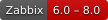
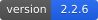
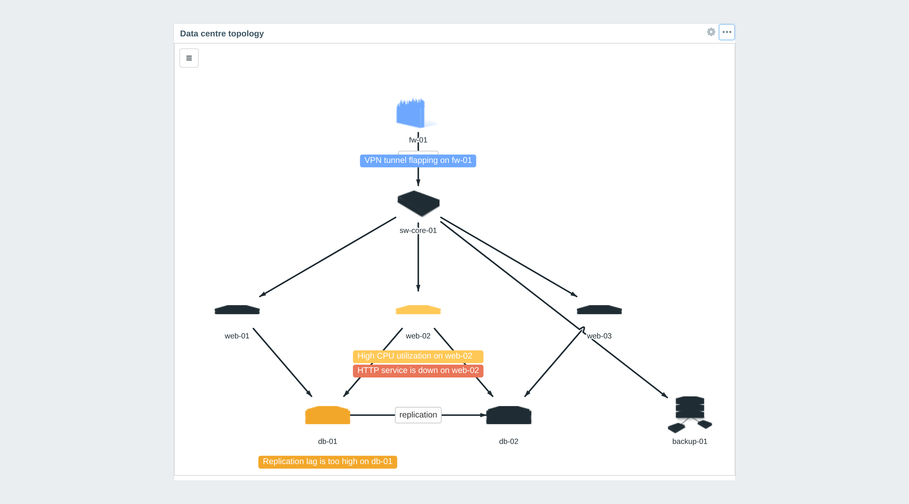
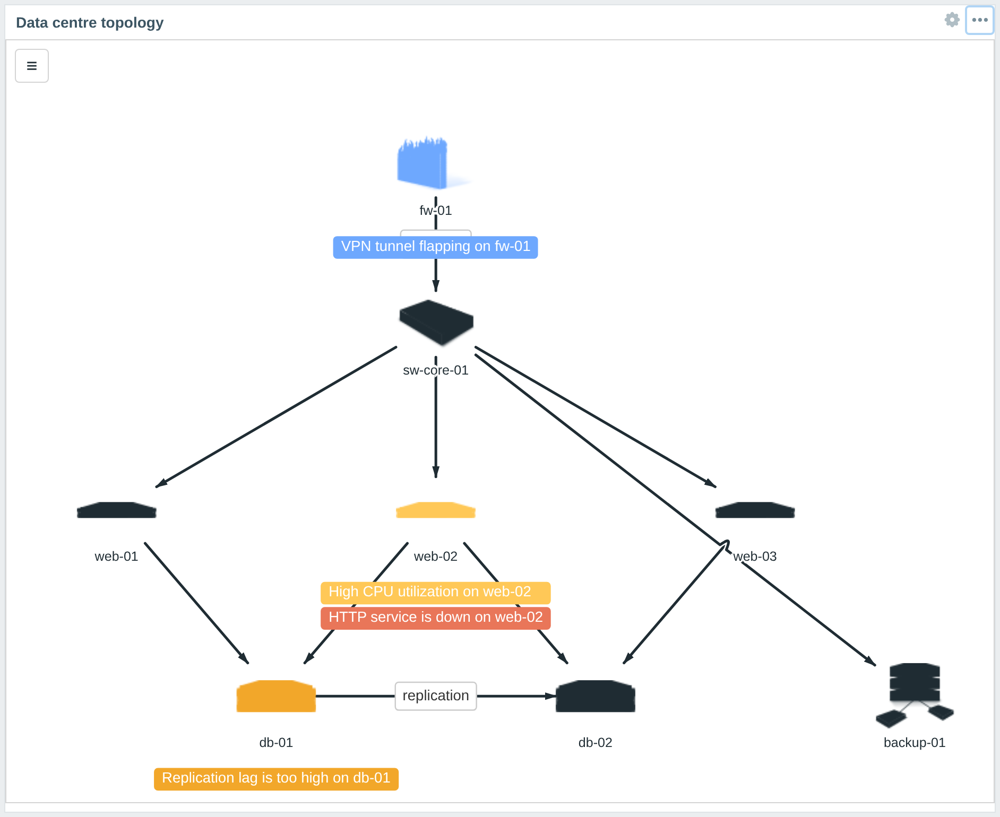
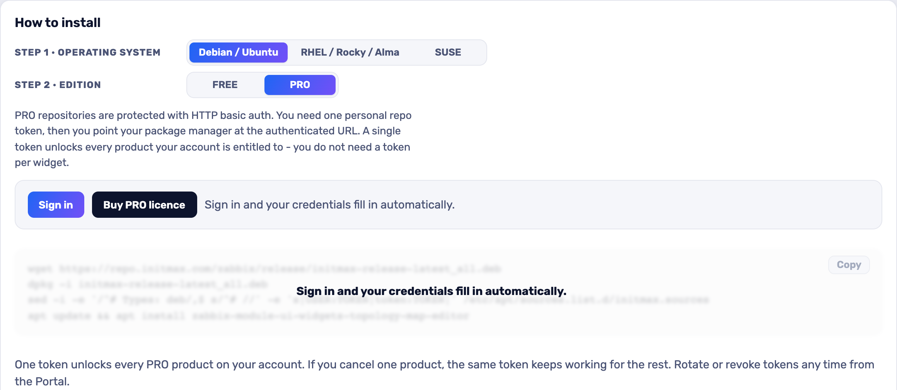

<h1>Topology Map Editor</h1>

developed and maintained by

and community

<strong>Draw your network on the dashboard, and let it show you the problems.</strong> 
Zabbix maps live on their own page and are edited on another one. This widget puts the canvas inside the dashboard: drag hosts onto it, connect them, arrange them in layers, and save it with the rest of the board.

<a href="#what-you-can-build"><strong>Features</strong></a> &nbsp;·&nbsp;
<a href="#examples"><strong>Examples</strong></a> &nbsp;·&nbsp;
<a href="#install"><strong>Install</strong></a> &nbsp;·&nbsp;
<a href="#free-vs-pro"><strong>FREE vs PRO</strong></a> &nbsp;·&nbsp;
<a href="https://portal.initmax.com"><strong>Portal</strong></a> &nbsp;·&nbsp;
<a href="https://www.initmax.com/wiki/"><strong>Docs</strong></a>

 

---

## Why Topology Map Editor

A Zabbix map answers "what is connected to what". Getting one built means leaving the dashboard, opening the map editor, saving, going back and refreshing - and the picture then sits on a page of its own, next to the boards people actually watch.

**Topology Map Editor** is the canvas, on the dashboard. Search for a host in the sidebar, drop it on the grid, draw the link, and press Save changes with everything else. The drawing is stored in the dashboard itself, so it travels with export, import and permissions like any other widget.

## What you can build

<table>
<tr>
<td width="50%" valign="top">

**Site and rack diagrams**
Hosts and groups dragged from the sidebar, arranged over a floor plan or a rack photo imported as PNG or PDF.

</td>
<td width="50%" valign="top">

**Layered network views**
Named layers with their own defaults and visibility - physical on one, logical on another, toggled while you look.

</td>
</tr>
<tr>
<td width="50%" valign="top">

**Annotated schematics**
Nodes, lines, text, comments and nine shapes, each with its own colours, border and label.

</td>
<td width="50%" valign="top">

**Reusable layouts**
Layer templates plus JSON export and import, so a standard site diagram is drawn once.

</td>
</tr>
<tr>
<td width="50%" valign="top">

**Live topology** &nbsp;PRO
Connections between any two objects, with labels, bend points and bridged crossings.

</td>
<td width="50%" valign="top">

**A board that alarms** &nbsp;PRO
Problem badges coloured by severity, trigger lists per element and maintenance state on the map.

</td>
</tr>
</table>

## Examples

<table>
<tr>
<td width="50%" align="center" valign="top"> <small><b>Map</b> - map</small></td>
</tr>
</table>

## Configuration

The widget form has one setting: the **Map** the editor is bound to. Everything else is drawn on the canvas itself - the sidebar switches between hosts, groups, a tag filter and the drawing palette, and the layers panel handles visibility and order. The form looks and behaves the same on every supported Zabbix version.

## Install

Both **FREE** and **PRO** ship as **GPG-signed `deb` / `rpm` packages** from the initMAX repository - `apt` / `dnf` installs them and keeps them updated. Same flow for both editions; PRO just adds your personal repo token.

### Easiest way - the guided installer on the Portal

Open the product page, pick your **OS** and **edition**, and copy the ready-made command. FREE is fully public (no login); PRO fills in your token once you sign in. There's a feedback box right there too.

<a href="https://portal.initmax.com/catalog/zabbix-topology-map-editor#how-to-install"><strong>→ Open the installer on the Portal</strong></a>

Prefer a plain archive? Every release also ships as a **ZIP** - FREE [straight from the repo](https://repo.initmax.com/zabbix/free/zip/topology-map-editor/), PRO with your repo token - handy for offline or manual installs.

The module is enabled automatically during the package installation - verify it in **Administration → General → Modules**. Done.

## FREE vs PRO

The FREE edition is a real editor: place, arrange, layer, save, reload and edit. The two paid capabilities are **absent from the FREE package** rather than switched off in the form - their code is not in the tarball, so the lock holds on the server and no crafted request can turn them on.

| Feature | FREE | PRO |
| ---------------------------------------------------------- | :----: | :----: |
| Draw a topology straight on the dashboard - hosts, groups, nodes, shapes, text, comments | ✅ | ✅ |
| Named layers with per-layer visibility, defaults and Z-order | ✅ | ✅ |
| Pan, zoom and a resettable viewport | ✅ | ✅ |
| Host and host-group search, and a tag filter, in the sidebar | ✅ | ✅ |
| PNG / PDF images placed, moved, rotated and locked on the canvas | ✅ | ✅ |
| Bind the editor to a Zabbix map | ✅ | ✅ |
| Layer templates, export and import | ✅ | ✅ |
| One package for Zabbix 6.0 - 7.4 | ✅ | ✅ |
| Localised into all Zabbix display languages | ✅ | ✅ |
| High availability ready | ✅ | ✅ |
| **Problem badges on elements, coloured by severity** | ❌ | ✅ |
| **Severity filter and a custom severity palette** | ❌ | ✅ |
| **Trigger lists per element, connection and shape** | ❌ | ✅ |
| **Maintenance state shown on the map, with problems optionally hidden** | ❌ | ✅ |
| **Connections between any two map objects, with labels** | ❌ | ✅ |
| **Line style, width, colour and transparency** | ❌ | ✅ |
| **Bend points, polylines and bridged crossings** | ❌ | ✅ |
| **Parallel connections aggregated into one line** | ❌ | ✅ |
| Licence | AGPLv3 | [Commercial](./LICENSE-PRO.md) |

## Requirements

|              |                                                              |
| ------------ | ------------------------------------------------------------ |
| **Zabbix**   | 6.0 · 6.2 · 6.4 · 7.0 · 7.2 · 7.4 - one package covers all    |
| **PHP**      | 7.4 or newer                                                 |
| **OS**       | Debian/Ubuntu · RHEL/Rocky/Alma/Oracle/Amazon · SUSE         |
| **Editions** | FREE (public repo) · PRO (token-gated repo)                  |
| **Background images** | PNG and PDF uploads need a writable `backgrounds/` directory inside the module - the widget says which path and which permissions if it is not |
| **Languages** | All 27 Zabbix display languages - the widget follows each user's own language setting |
| **High availability** | Ready. The drawing is stored in the Zabbix database as widget fields and there is no server-side component and no local state; install it on every frontend node of an HA cluster and any node can serve it |

### One package, every supported version

Zabbix 6.0 and 6.2 accept only version 1 of the module manifest and 6.4 and newer only version 2, so the package carries both module trees and the installer deploys the one your frontend can load. The markup, the client, the stylesheet and the stored field names are the same code either way, so a topology drawn on 6.0 opens unchanged after an upgrade to 7.4, and the configuration dialog offers the same field, with the same label, in the same place on all six versions.

Two limits of the older frontends are worth knowing before you install. Neither is a knob that does nothing - the widget simply behaves within what the frontend allows:

- **A single map is larger on 7.0 and newer.** The drawing is stored in Zabbix's own `widget_field` rows, which hold 255 characters each up to 6.4 and 2048 from 7.0. The widget measures the limit and splits the drawing to fit, so the practical ceiling is roughly 250 kB of topology per widget on 6.0 - 6.4 and about eight times that from 7.0. A map of a few hundred elements is far below either.
- **The Map picker is a "Select" popup on 6.2**, not the type-ahead multiselect the other versions draw, because Zabbix 6.2 has no map multiselect field. It picks the same maps and stores the same value.

## Support &amp; links

- **[Portal](https://portal.initmax.com)** - downloads, tokens, support tickets
- **Source code (FREE, AGPLv3)** - included in every package and published as a [source archive](https://repo.initmax.com/zabbix/free/zip/topology-map-editor/) on repo.initmax.com
- **[support@initmax.com](mailto:support@initmax.com)**

---

FREE: <a href="https://www.gnu.org/licenses/agpl-3.0.html">AGPLv3</a> &nbsp;·&nbsp; PRO: <a href="./LICENSE-PRO.md">commercial</a> &nbsp;·&nbsp; © 2021-2026 initMAX s.r.o.

